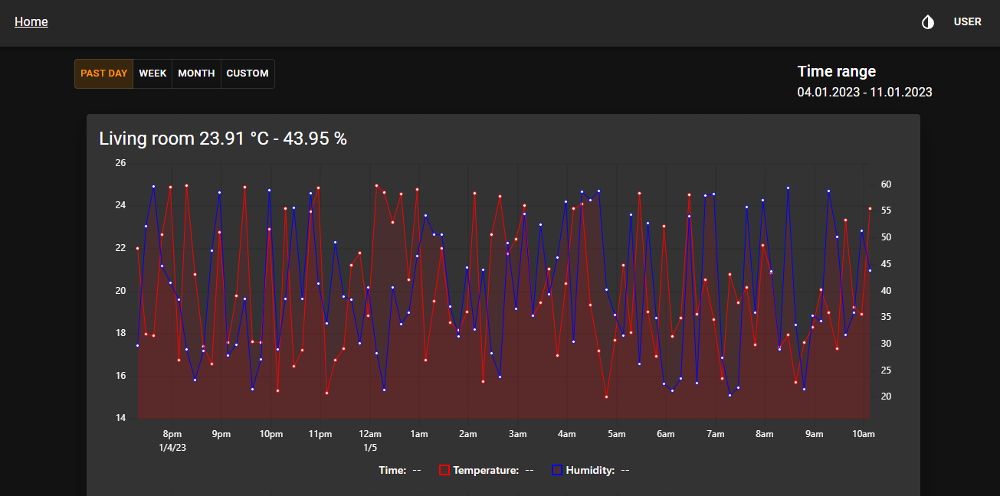

# measurements-app

Exercise for collecting [RuuviTag](https://ruuvi.com/fi/ruuvitag/) measurements and displaying them in React app.



## Components

### [measurements-app](src/measurements-app/README.md)

React application for charting the measurents data.

### [measurements-api](src/measurements-api/README.md)

Net Core API for managing sensors and storing measurements data.

### [measurements-collector](src/measurements-collector/README.md)

Python script for collecting RuuviTag data and publishing it to the API.

## Start local environment

Build and start

```
docker compose build
docker compose up -d
```

After system is up collector will publish mock data on 30 second intervals.

> For token validation to work keycloak and react app must have following aliases.On windows `hosts` file can be found from `C:\Windows\System32\drivers\etc`

```
127.0.0.1 keycloak.local
127.0.0.1 measurements-app.local
```

Following table lists components and url's...

| Component               | Url                                          | Notes                        |
| ----------------------- | -------------------------------------------- |------------------------------|
| React app               | http://measurements-app.local:8001           | Username `user` pw `foobar`  |
| Keycloak admin panel    | http://keycloak.local:8080/admin             | Username `admin` pw `admin`  |
| PostgreSQL Database     | postgresql://localhost:5432/MeasurementsDB   | Username `measurements_user` pw `measurements_pass` |
| API swagger doc         | http://localhost:7001/swagger                |                              |

Stop

```
docker compose down
```

Stop and remove volumes

```
docker compose down -v --remove-orphans
```

## PostgreSQL + TimescaleDB

The application uses PostgreSQL with TimescaleDB extension for optimized time-series data storage. TimescaleDB automatically:

- Partitions measurement data by time (1-day chunks)
- Compresses data older than 7 days (90%+ storage reduction)  
- Automatically deletes data older than 1 year
- Optimizes queries for time-range operations

You can connect to the database using any PostgreSQL client with the credentials listed above.

## Code generation

This project uses design first approach for API development. When openapi spec is updated code should be generated using script

```shell
cd src/openapi
./generate.sh
```

This will generate API controllers and typescript and python clients.

## Known issues

None currently known with the PostgreSQL + TimescaleDB setup.

## Links

https://www.keycloak.org/getting-started/getting-started-docker
